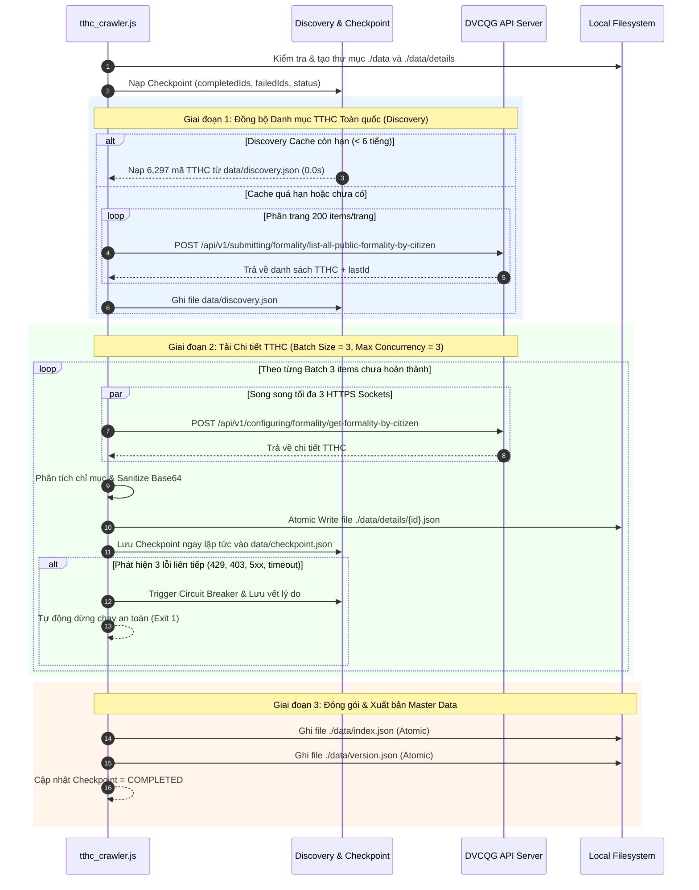
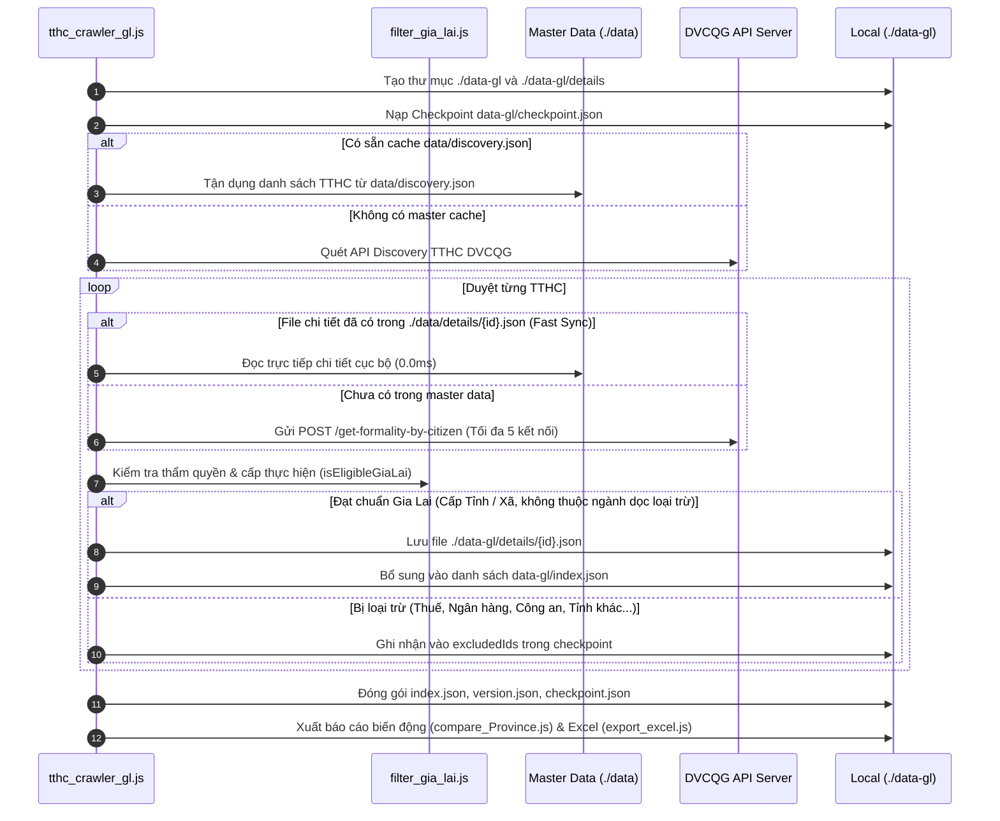

# 🚀 Crawler TTHC - Cổng Dịch vụ công Quốc gia (DVCQG)

> Hệ thống tự động thu thập, xử lý và xuất bản Master Data Thủ tục Hành chính (TTHC) toàn quốc từ Cổng Dịch vụ công Quốc gia (`dichvucong.gov.vn`).

---

## 📌 Tổng quan dự án

Dự án cung cấp giải pháp cào dữ liệu quy mô lớn (> 6,000+ TTHC) với hiệu năng cao, cơ chế vượt tường lửa (Anti-WAF/Anti-Bot) tiên tiến, và quy trình CI/CD chạy hoàn toàn tự động trên GitHub Actions.

### ✨ Nguyên tắc Thiết kế & Tính năng Nổi bật
- **⚡ Controlled Concurrency (Tối đa 5 kết nối song song):** Giới hạn tối đa 5 kết nối HTTPS socket đồng thời (`maxSockets: 5`), tối ưu tốc độ thu thập dữ liệu trong khi vẫn giữ an toàn tuyệt đối với tường lửa.
- **🛡️ Conservative Rate & Jitter:** Sử dụng delay cơ sở (300ms) kết hợp nhiễu ngẫu nhiên (Jitter 0-200ms) giữa các đợt request để giữ tải ở mức lịch sự và tự nhiên.
- **⚡ Discovery Caching:** Tự động lưu cache danh mục toàn quốc vào `data/discovery.json`. Các lần chạy tiếp theo (< 6 tiếng) sẽ khởi động tức thì mà không cần quét lại 32 trang API danh mục.
- **⚡ Immediate Checkpointing:** Lưu tiến độ ngay lập tức vào `data/checkpoint.json` sau mỗi item. Khi tiến trình bị gián đoạn, hệ thống tự động tiếp tục tại item chưa tải mà không cần cào lại dữ liệu đã hoàn thành.
- **🔒 Circuit Breaker (Cầu chì an toàn):** Tự động phát hiện 3 lỗi phản hồi/tường lửa liên tiếp (429, 403, 5xx, timeout) để chủ động ngắt tiến trình an toàn và lưu vết lý do.
- **✅ Fail-Closed & Payload Verification:** Xác minh nghiêm ngặt cấu trúc phản hồi `res.data.code === 'OK'` thay vì tin tưởng mù quáng vào HTTP 200/201.
- **🛡️ Atomic JSON Writes & Graceful Teardown:** Sử dụng cơ chế ghi file nguyên tử (`safeWriteJson`) qua file tạm `.tmp` và bắt sự kiện ngắt đột ngột (`SIGINT`, `SIGTERM`) để chống hỏng file JSON khi bị ngắt.
- **📦 Xuất bản Dữ liệu Tối ưu:** Dữ liệu tự động đẩy ra nhánh `data` riêng biệt với cờ `--force-orphan`, giữ cho repository gốc luôn gọn nhẹ.
- **🏛️ Chuyên biệt hóa TTHC Tỉnh Gia Lai (`data-gl`):** Tích hợp engine lọc thông minh (`filter_gia_lai.js` và `tthc_crawler_gl.js`), tự động phân loại TTHC cấp Tỉnh, cấp Xã áp dụng tại Gia Lai, loại trừ các ngành dọc (Thuế, Ngân hàng, Tòa án, Hải quan, Công an, Cục/Vụ TW) và các TTHC đặc thù tỉnh khác. Hỗ trợ Fast Sync tái sử dụng dữ liệu toàn quốc giúp tiết kiệm tối đa thời gian và băng thông.

---

## 🏗️ Kiến trúc Hệ thống & Luồng Dữ liệu

### 1. Kiến trúc Tổng quan (System Architecture)

```mermaid
graph TD
    A[⏰ GitHub Actions Scheduler\n23:30 GMT+7] -->|Kích hoạt Workflow| B[🚀 auto_crawl.yml]
    C[👤 Manual Workflow Dispatch] -->|Chạy thủ công| B
    
    subgraph "Engine Cào Dữ Liệu Toàn quốc (Node.js)"
        B --> D[📜 tthc_crawler.js]
        D -->|1. Discovery Engine / Cache| E[📄 data/discovery.json]
        D -->|2. Max 5 Connections| F[🛡️ Anti-WAF Session Engine]
        F -->|3. Verified POST API| G[🌐 dichvucong.gov.vn]
        G -->|4. JSON Response| F
        F -->|5. Immediate Checkpoint| H[📄 data/checkpoint.json]
        F -->|6. Atomic JSON Write| I[📁 Local ./data directory]
    end

    subgraph "Engine Xử lý Chuyên biệt Tỉnh Gia Lai"
        B --> D2[📜 tthc_crawler_gl.js]
        I -.->|Fast Sync (Tận dụng details có sẵn)| D2
        D2 -->|Bộ lọc filter_gia_lai.js| I2[📁 Local ./data-gl directory]
        D2 -->|Missing Fetch API| G
        I2 --> J2[📄 data-gl/index.json]
        I2 --> K2[📄 data-gl/version.json]
        I2 --> L2[📂 data-gl/details/*.json]
    end

    subgraph "Data Storage & Distribution"
        I -->|peaceiris/actions-gh-pages| M[🌐 Branch: data]
        I2 -->|peaceiris/actions-gh-pages| M2[🌐 Branch: data-gl]
    end

    subgraph "TCI Calibration Pipeline"
        M -->|Event Trigger| N[⚙️ tci_calibration.yml]
        N --> O[📜 select-tci-calibration.js]
        N --> P[📜 select-golden-cases.js]
        O & P --> Q[📊 tci-results / Branch: tci-calibration]
    end
```

---

### 2. Luồng Xử lý Chi tiết (Data Crawling Sequence)



---

### 3. Luồng Xử lý Dữ liệu Chuyên biệt Tỉnh Gia Lai (Gia Lai Pipeline)



---

## 📁 Cấu trúc Thư mục Dự án

```text
Crawler-TTHC/
├── .github/
│   └── workflows/
│       ├── auto_crawl.yml          # Workflow chạy cào dữ liệu tự động 23:30 hàng ngày (Xuất data & data-gl)
│       └── tci_calibration.yml     # Workflow phân tích mẫu hiệu chỉnh TCI
├── data/                           # Thư mục dữ liệu toàn quốc (Toàn bộ 6,800+ TTHC)
│   ├── index.json                  # Chỉ mục toàn bộ TTHC
│   ├── version.json                # Thông tin phiên bản & thời gian cập nhật
│   ├── discovery.json              # Cache danh mục TTHC toàn quốc (< 6h)
│   ├── checkpoint.json             # Lưu vết tiến độ & trạng thái Circuit Breaker
│   ├── compare_report.json         # Báo cáo biến động toàn quốc (Thêm mới, bãi bỏ, sửa đổi)
│   ├── snapshot.json               # Snapshot lưu trữ so sánh biến động kỳ này/kỳ sau
│   ├── Bao_cao_TTHC_DVCQG.xlsx     # Báo cáo Master Data Excel 5 Sheets Cổng DVCQG toàn quốc
│   └── details/                    # Chi tiết từng TTHC dạng JSON
├── data-gl/                        # Thư mục dữ liệu CHUYÊN BIỆT TỈNH GIA LAI (Cấp tỉnh & Xã đã lọc)
│   ├── index.json                  # Chỉ mục TTHC áp dụng tại Gia Lai
│   ├── version.json                # Thông tin phiên bản, số lượng cấp tỉnh, cấp xã, tỷ lệ loại trừ
│   ├── discovery.json              # Danh sách discovery TTHC Gia Lai
│   ├── checkpoint.json             # Checkpoint tiến độ lọc riêng Gia Lai
│   ├── snapshot.json               # Snapshot lưu trữ để so sánh biến động kỳ này/kỳ sau
│   ├── compare_report.json         # Báo cáo biến động TTHC Gia Lai (Thêm mới, bãi bỏ, sửa đổi)
│   ├── Bao_cao_TTHC_Gia_Lai.xlsx   # Báo cáo Master Data Excel 4 Sheets cho tỉnh Gia Lai
│   └── details/                    # Chi tiết từng TTHC của Gia Lai
├── scripts/
│   ├── filter_gia_lai.js           # Bộ lọc chuẩn TTHC Gia Lai (Cấp tỉnh, cấp xã; trừ thuế, ngân hàng, tòa án, hải quan, công an, cục/vụ)
│   ├── compare_Province.js         # Phân tích so sánh biến động TTHC cấp tỉnh & xã Gia Lai
│   ├── export_excel.js             # Xuất file Excel báo cáo TTHC Gia Lai & Toàn quốc
│   ├── compare.js                  # Phân tích biến động TTHC toàn quốc
│   ├── publish.js                  # Xuất bản dữ liệu lên nhánh data/data-gl & gửi Telegram
│   ├── setup_env.js                # Công cụ cấu hình biến môi trường tương tác
│   ├── crawl_and_publish.sh        # Shell script thực thi trọn gói trên Linux/macOS
│   └── crawl_and_publish.bat       # Batch script thực thi trọn gói trên Windows
├── tthc_crawler.js                 # Engine cào dữ liệu TTHC toàn quốc
├── tthc_crawler_gl.js              # Engine cào & đồng bộ dữ liệu TTHC chuyên biệt Tỉnh Gia Lai
├── run.bat                         # Menu điều khiển trực quan trên Windows
└── README.md                       # Tài liệu hướng dẫn hệ thống
```

---

## 🛠️ Hướng dẫn Sử dụng

### 1. Yêu cầu Môi trường
- **Node.js**: phiên bản `>= 18.0.0`
- **npm**: phiên bản `>= 9.0.0`

### 2. Cài đặt Dependency
```bash
npm install
cp .env.example .env   # Tạo file cấu hình từ mẫu
```

### 3. Cấu hình Biến Môi trường (.env)
Tạo file `.env` tại thư mục gốc với các tùy chọn:
```ini
# Cấu hình Upload Repository (true: cho phép đẩy code, false: chỉ lưu data cục bộ)
UPLOAD_REPO=true
GIT_REMOTE_NAME=origin
GITHUB_TOKEN=ghp_YourGitHubPersonalAccessToken  # Token quyền push repo (tùy chọn)
GIT_MAIN_BRANCH=main
GIT_DATA_BRANCH=data

# Cấu hình thông báo Telegram
TELEGRAM_ENABLE=true
TELEGRAM_BOT_TOKEN=123456789:ABCdefGhIJKlmNoPQRsTUVwxyZ
TELEGRAM_CHAT_ID=-100xxxxxxxxxx
TELEGRAM_TOPIC_ID=    # Để trống nếu không dùng topic trong supergroup
```

### 4. Chạy trên Windows
- Bấm đúp vào file `run.bat` tại thư mục gốc để mở giao diện Menu điều khiển trực quan:
  - Phím `[1]`: Cào dữ liệu TTHC toàn quốc mới nhất (`node tthc_crawler.js`)
  - Phím `[8]`: Cào và lọc dữ liệu TTHC Gia Lai riêng biệt (`node tthc_crawler_gl.js`)
  - Phím `[2]`: So sánh biến động TTHC toàn quốc và cấp tỉnh
  - Phím `[7]`: Xuất file Excel báo cáo TTHC Gia Lai (`Bao_cao_TTHC_Gia_Lai.xlsx`)
  - Phím `[3]`: Chạy toàn bộ quy trình từ A - Z (Toàn quốc + Gia Lai + So sánh + Excel + Git Publish + Telegram)
- Hoặc chạy trực tiếp quy trình xuất bản qua lệnh:
```cmd
scripts\crawl_and_publish.bat
```
- Hoặc chạy nhanh các tác vụ Gia Lai bằng tham số dòng lệnh:
```cmd
run.bat crawl-gl    :: Chạy crawler thu thập/lọc TTHC Gia Lai
run.bat excel       :: Xuất file Excel báo cáo Master Data & biến động Gia Lai
```

### 5. Chạy thủ công trên Linux / macOS
```bash
# 1. Chạy riêng cỗ máy cào dữ liệu toàn quốc
node tthc_crawler.js

# 2. Chạy riêng cỗ máy thu thập và lọc TTHC Gia Lai (data-gl)
node tthc_crawler_gl.js
# Hoặc sử dụng npm script:
npm run crawl:gl

# 3. Phân tích so sánh biến động TTHC Gia Lai
node scripts/compare_Province.js
# Hoặc: npm run compare:gl

# 4. Xuất file Excel Master Data Gia Lai (4 Sheets)
node scripts/export_excel.js --gl
# Hoặc: npm run export:excel:gl

# 5. Hoặc chạy toàn bộ quy trình tự động từ A - Z (Toàn quốc + Gia Lai + So sánh + Excel + Upload + Telegram)
bash scripts/crawl_and_publish.sh
```

### 6. Quy trình Thu thập & Xử lý Dữ liệu TTHC Tỉnh Gia Lai

Hệ thống cung cấp pipeline chuyên biệt dành riêng cho tỉnh Gia Lai nhằm phục vụ số hóa, theo dõi biến động và lập báo cáo quản trị:

#### 🎯 Quy tắc & Tiêu chí Lọc Chuẩn (`scripts/filter_gia_lai.js`)
| Tiêu chí | Quy chuẩn áp dụng | Cơ chế xử lý |
| :--- | :--- | :--- |
| **Cấp thực hiện** | Chỉ lấy TTHC thuộc thẩm quyền giải quyết của **Cấp Tỉnh** hoặc **Cấp Xã** (hoặc cả 2 cấp). | Tự động loại bỏ các thủ tục Cấp Bộ, Cấp Huyện (theo mô hình phân cấp mới) hoặc cơ quan trung ương khác. |
| **Phạm vi thẩm quyền** | TTHC do Trung ương quy định áp dụng toàn quốc hoặc do UBND tỉnh Gia Lai ban hành (Mã định danh `H21` hoặc cơ quan ban hành có chứa chuỗi `"Gia Lai"`). | Loại trừ triệt để TTHC mang tính quy định địa phương / đặc thù của 62 tỉnh, thành phố khác. |
| **Loại trừ ngành dọc** | Tự động sàng lọc loại bỏ thủ tục thuộc các ngành dọc đóng trên địa bàn: | <ul><li>**Thuế:** Cục Thuế, Chi cục Thuế, Tổng cục Thuế...</li><li>**Ngân hàng:** Ngân hàng Nhà nước, Chi nhánh NHNN, NHCSXH...</li><li>**Tòa án:** Tòa án nhân dân các cấp...</li><li>**Hải quan:** Cục Hải quan, Chi cục Hải quan...</li><li>**Công an:** Bộ Công an, Công an tỉnh, huyện, xã, PCCC, Quản lý XNC...</li><li>**Cục/Vụ TW:** Các Cục, Vụ thuộc Bộ/ngành không thuộc thẩm quyền địa phương.</li></ul> |
| **Cơ chế Fast Sync** | Tận dụng Master Data sẵn có trong `./data` | Nếu `./data/discovery.json` và `./data/details/` đã tồn tại, crawler sẽ trích xuất và lọc ngay lập tức (0.0ms) mà không gửi request dư thừa lên cổng DVCQG. |

#### 📋 Các lệnh hỗ trợ nhanh cho Gia Lai qua NPM:
```bash
npm run crawl:gl           # Thu thập và lọc TTHC Gia Lai vào data-gl/
npm run compare:gl         # Phân tích biến động (thêm mới/sửa đổi/bãi bỏ) tại Gia Lai
npm run export:excel:gl    # Xuất file Excel báo cáo Master Data Gia Lai (4 Sheets)
npm run export:excel:all   # Xuất cả file Excel Toàn quốc và Excel Gia Lai
```

### 7. Chạy phân tích TCI Calibration
```bash
node tci/select-tci-calibration.js
node tci/select-golden-cases.js
```

---

## 📊 Cấu trúc Dữ liệu Đầu ra (Output Specification)

### 1. Dữ liệu Toàn quốc (`data/`)

#### `data/index.json`
Chứa bảng chỉ mục rút gọn của toàn bộ TTHC toàn quốc:
```json
[
  {
    "id": "01a0a85c-80c6-768f-b7b9-e04942933ace",
    "ma_tthc": "5.003882",
    "ten_tthc": "Xây dựng kế hoạch xử lý, cải tạo và phục hồi ô nhiễm môi trường...",
    "cap_thuc_hien": "Cấp tỉnh",
    "loai_tthc": "TTHC Tiêu chuẩn",
    "linh_vuc": "Môi trường",
    "co_quan_thuc_hien": "Cơ quan chuyên môn về nông nghiệp và môi trường thuộc UBND cấp tỉnh"
  }
]
```

#### `data/version.json`
Chứa thông tin metadata của đợt quét toàn quốc:
```json
{
  "last_updated": "2026-09-17T15:30:00.000Z",
  "total_records": 6297,
  "completed_records": 6297,
  "failed_records": 0,
  "circuit_breaker_status": "COMPLETED"
}
```

#### `data/checkpoint.json`
Chứa bảng lưu vết trạng thái chi tiết từng item và cầu chì an toàn:
```json
{
  "completedIds": {
    "01a0a85c-80c6-768f-b7b9-e04942933ace": {
      "code": "5.003882",
      "timestamp": "2026-09-17T20:20:00.000Z",
      "verified": true
    }
  },
  "failedIds": {},
  "consecutiveFailures": 0,
  "lastUpdated": "2026-09-17T20:20:00.000Z",
  "status": "COMPLETED",
  "circuitBreakerReason": null
}
```

#### `data/details/{id}.json`
Chứa toàn bộ cây dữ liệu chi tiết của 1 thủ tục (đã được dọn dẹp các chuỗi mã hóa Base64 của hình ảnh đính kèm để tối ưu dung lượng).

---

### 2. Dữ liệu Chuyên biệt Tỉnh Gia Lai (`data-gl/`)

Thư mục `./data-gl/` lưu trữ toàn bộ dữ liệu đã qua xử lý theo bộ lọc chuẩn của tỉnh Gia Lai:

#### `data-gl/index.json`
Danh mục chỉ mục rút gọn các TTHC có hiệu lực thi hành tại Gia Lai:
```json
[
  {
    "id": "01a0a85c-80c6-768f-b7b9-e04942933ace",
    "ma_tthc": "5.003882",
    "ten_tthc": "Xây dựng kế hoạch xử lý, cải tạo và phục hồi ô nhiễm môi trường...",
    "cap_thuc_hien": "Cấp tỉnh",
    "loai_tthc": "TTHC Tiêu chuẩn",
    "linh_vuc": "Môi trường",
    "co_quan_thuc_hien": "Cơ quan chuyên môn về nông nghiệp và môi trường thuộc UBND cấp tỉnh",
    "isProvince": true,
    "isWard": false,
    "url": "https://dichvucong.gov.vn/p/home/dvc-tthc-thu-tuc.html?ma_thu_tuc=5.003882"
  }
]
```

#### `data-gl/version.json`
Thống kê tổng quan tỷ lệ phân bổ và các chỉ số sàng lọc:
```json
{
  "last_updated": "2026-10-18T15:30:00.000Z",
  "total_eligible_gl": 1845,
  "province_level_count": 1420,
  "ward_level_count": 425,
  "both_levels_count": 85,
  "excluded_count": 4452,
  "exclusion_breakdown": {
    "TỈNH_KHÁC": 2100,
    "THUẾ": 350,
    "CÔNG AN": 420,
    "NGÂN HÀNG": 80,
    "TÒA ÁN": 45,
    "HẢI QUAN": 95,
    "CỤC_VỤ": 1362
  },
  "circuit_breaker_status": "COMPLETED"
}
```

#### `data-gl/compare_report.json` & `snapshot.json`
Ghi nhận biến động TTHC Gia Lai giữa các kỳ quét (Thêm mới, sửa đổi nội dung, bãi bỏ/hết hiệu lực), làm đầu vào phân tích cho các báo cáo giám sát.

#### `data-gl/Bao_cao_TTHC_Gia_Lai.xlsx`
Báo cáo Master Data Excel gồm 4 Sheets trình bày chuyên nghiệp:
1. **`TTHC Cấp Tỉnh`**: Danh mục toàn bộ thủ tục cấp tỉnh đang áp dụng.
2. **`TTHC Cấp Xã`**: Danh mục toàn bộ thủ tục cấp xã đang áp dụng.
3. **`Cả 2 Cấp (Tỉnh & Xã)`**: Các thủ tục thực hiện liên thông hoặc có thẩm quyền ở cả hai cấp.
4. **`Biến động TTHC`**: Chi tiết các thủ tục mới ban hành, sửa đổi hoặc bãi bỏ so với kỳ quét trước.

---

## ⚙️ Cấu hình GitHub Actions

| Workflow | Trigger | Lịch / Điều kiện | Nhiệm vụ |
| :--- | :--- | :--- | :--- |
| **`auto_crawl.yml`** | `schedule` / `workflow_dispatch` | `30 16 * * *` (23:30 VN) | <ul><li>Chạy crawler toàn quốc (`tthc_crawler.js`)</li><li>Chạy crawler & lọc dữ liệu Gia Lai (`tthc_crawler_gl.js`)</li><li>Phân tích so sánh biến động toàn quốc & cấp tỉnh (`compare.js`, `compare_Province.js`)</li><li>Xuất bản `./data` ra nhánh `data` (force-orphan)</li><li>Xuất bản `./data-gl` ra nhánh `data-gl` (force-orphan)</li><li>Gửi thông báo kết quả qua Google Apps Script / Telegram Webhook</li></ul> |
| **`tci_calibration.yml`** | `push` / `workflow_dispatch` | Khi có thay đổi code TCI / detail | Phân tích 50 mẫu calibration & 15 Golden Cases, push lên nhánh `tci-calibration`. |

---

## 🛡️ Giấy phép & Bản quyền
Dự án được duy trì bởi **Kyn Chou** cho mục đích nghiên cứu và thu thập dữ liệu phục vụ Dịch vụ công. Dữ liệu thuộc bản quyền công khai của Cổng Dịch vụ công Quốc gia Việt Nam.
